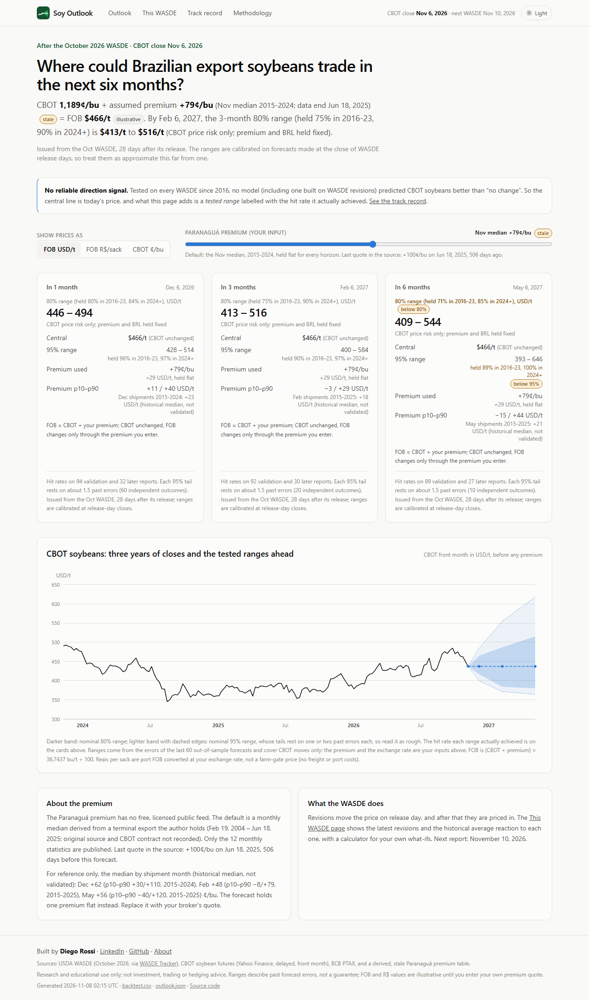
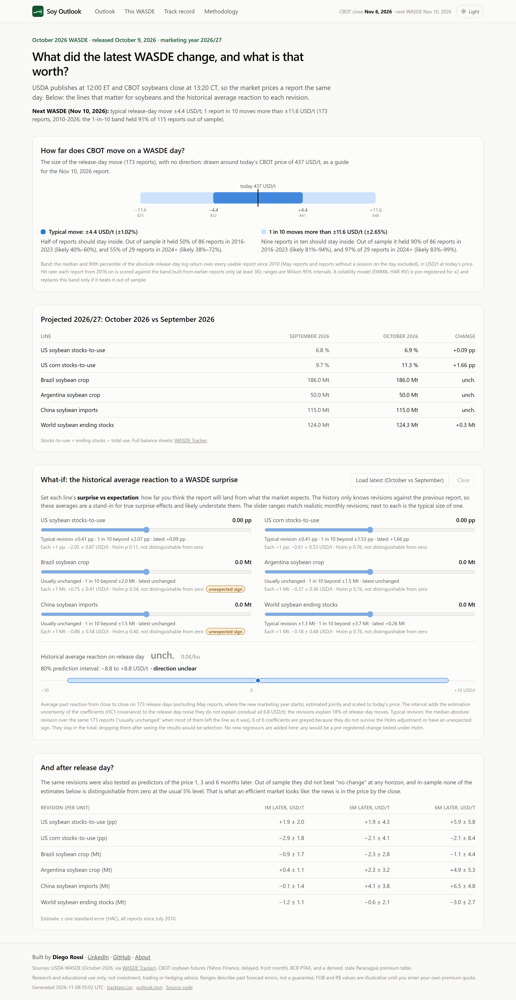
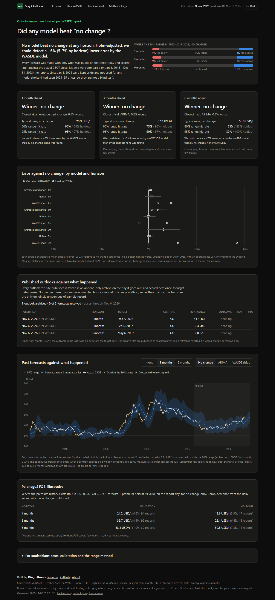
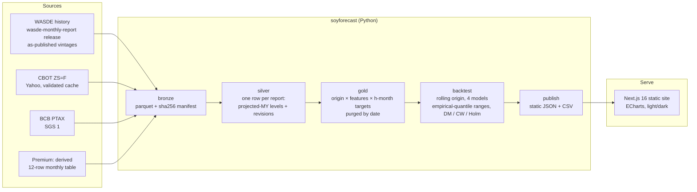

# Soy Outlook: Brazilian soybean prices after each WASDE

**Where could Paranaguá export soybeans trade 1, 3 and 6 months after a USDA WASDE report, and how sure can anyone be?**

**[Live site → soy-outlook.vercel.app](https://soy-outlook.vercel.app)**

Built by **Diego Rossi** · [LinkedIn](https://www.linkedin.com/in/rossi-diego/) · [GitHub](https://github.com/rossi-diego)

[](https://github.com/rossi-diego/sarimax-brazilian-soybean-forecasting/actions/workflows/ci.yml)
[](https://github.com/rossi-diego/sarimax-brazilian-soybean-forecasting/actions/workflows/refresh.yml)


[](https://github.com/astral-sh/ruff)
[](https://soy-outlook.vercel.app)
[](LICENSE)

### What this project demonstrates

- **Honest forecast evaluation.** Rolling-origin backtest on every WASDE since 2010 with point-in-time data, purging by date, a validation/holdout split and a model-selection rule fixed in advance (Clark-West, Holm-adjusted).
- **A null result reported as a finding.** No model beats "no change" for CBOT soybeans; the site is built around that, showing ranges labelled by the hit rate they actually achieved instead of a direction call.
- **Market-risk judgement.** FOB = CBOT + port premium, with the premium and FX as explicit inputs, a stale-input badge, and bands labelled "CBOT price risk only" until a joint band is earned.
- **Statistics that survive scrutiny.** A release-day event study with HC1 errors, a Holm adjustment, placebo, split-sample and roll-exclusion checks, and an 80% prediction interval in the what-if.
- **End-to-end engineering.** Typed Python package (bronze → silver → gold → publish), structured logging, 80%+ test coverage, a static Next.js site with a Playwright contract test that keeps the copy in line with the JSON, CI and Docker.



---

## The answer, in one paragraph

The Paranaguá FOB price is the CBOT soybean price plus a port premium. This project forecasts the CBOT part after every WASDE since July 2010, using only what was public that day. **The finding: no model beat "no change".** That includes ARIMA, the average past change and a ridge regression on WASDE revisions, and it holds for both the 2016–2023 validation period and the 2024–2026 holdout, which was not used for any model choice (I had seen 2024–25 prices, so it is not a blind test). In a liquid futures market that is the expected result, and showing it with a test fixed in advance is more useful than a leaky "1.46% MAPE". What the project does deliver:

1. **A tested range, labelled by what it achieved.** Over 2016–2023, the 1-month 80% range held the actual price 80% of the time; on the holdout it held 84%. The 6-month 80% range held only 71% in validation, and the site says so next to it.
2. **The size of a WASDE release-day move, and an honest read of what drives it.** The typical release-day move is about ±4.4 USD/t, and 1 report in 10 moves CBOT by more than ±11.6 USD/t. The revisions jointly explain 18% of those moves, but no single revision coefficient survives a Holm adjustment across the six tested (the strongest, US soybean stocks-to-use, has Holm p = 0.11), and that one is unstable: about −5.6 USD/t per pp in 2010–2017, −0.6 from 2018.
3. **The premium and the exchange rate as explicit inputs.** That turns the CBOT range into FOB USD/t or R$ per sack. The default premium is one stale monthly median held flat, so "CBOT unchanged" means FOB unchanged.

| CBOT, USD/t, mean absolute error | 1 month | 3 months | 6 months |
|---|---|---|---|
| No change (random walk), validation 2016–2023 | **20.3** | **37.3** | **50.8** |
| ARIMA(0,1,1) | 20.5 | 37.3 | 51.0 |
| Average past change | 20.4 | 38.0 | 52.4 |
| WASDE ridge regression | 21.3 | 38.7 | 53.9 |
| No change, holdout 2024-01 → 2026-10 | 14.2 | 20.3 | 31.4 |
| 80% range hit rate, validation / holdout | 80% / 84% | 75% / 90% | 71% / 85% |
| 95% range hit rate, validation / holdout | 96% / 97% | 90% / 97% | 89% / 100% |

Values as of the CBOT close of 6 Nov 2026 and the October 2026 WASDE. They regenerate on every run (`web/public/data/metrics.csv`).

- **No challenger passes** the Clark-West test against no change, Holm-adjusted across all nine model × horizon tests (all adjusted p = 1.0).
- **The tests had power.** The minimum detectable effect (one-sided 5%, 80% power, HAC errors) is about a 6% lower MAE for the ridge model (5–7% across horizons) and 1–4% for ARIMA and the average past change. Improvements that size were detectable; none was found.
- **The ridge model is *worse*** than no change. On the primary loss (squared log-return error) Diebold-Mariano p = 0.06, 0.11 and 0.07 at 1, 3 and 6 months; on the secondary absolute USD/t error, p = 0.046 and 0.017 at 1 and 6 months. The average past change is worse at 1 month (p = 0.02).
- **Inference rule v2.** Version 1 mixed losses (DM on USD/t absolute errors, Clark-West on squared log returns, a MAE tie-break) and used an iid binomial direction test on overlapping windows. Version 2, fixed in `config.py` on 2026-11-08, uses one primary loss, Holm across all nine tests, a champion that must also have the lower primary loss, and a HAC Pesaran-Timmermann direction test. No conclusion changed.
- **The 6-month range is too narrow** in validation: it held 71% of outcomes, not 80%. The page shows these hit rates next to every range.
- **How the ranges are built.** Empirical quantiles of the last 60 realized out-of-sample errors, centred on their median. The centring (raw vs median) was fixed as a two-way choice in `config.py` before the comparison was run and chosen on validation only by interval score (median: 0.974 of the raw score). On the holdout it scored 1.008, slightly worse, which is reported rather than acted on. It is *not* split-conformal: overlapping windows break exchangeability, and each 95% bound rests on one or two past errors.
- **Volatility-scaled ranges did not beat it.** Two alternatives were fixed in `config.py` before any result: EWMA(λ = 0.94) filtered historical simulation (the one challenger) and a plain lognormal band from 63-session realized vol (the naive benchmark). On validation their interval scores were 1.10 and 1.07 times the baseline's, so the empirical ranges stay. On the holdout the plain vol band scored 0.80, better; that is reported, not acted on, because the holdout never chooses.
- **How uncertain the hit rates are.** Each comes with a moving-block bootstrap 95% CI and an effective sample size: the 6-month 80% range held 71% in validation, likely 54–87%, from about 32 independent outcomes. Misses are split by tail: in validation most 80% misses are on the upside (19% of 6-month outcomes above the range, 10% below). For the published (no change) ranges, Kupiec and Christoffersen tests on non-overlapping subsamples find no rejection at 5%.

## What the first version got wrong

The original repository claimed a **1.46% MAPE against 13.6% for a naive forecast**. I audited it from three angles (ML rigour, data sourcing, stakeholder product), using a separate AI-assisted review for each as a second pair of eyes, and confirmed the findings below:

| Problem | Where | Effect |
|---|---|---|
| A feature multiplied corn by the **target itself** (`corn_soy_price_interaction = corn_quote * soybean`), and it ranked as the "74% driver" | `notebooks/archive/04-sarimax.ipynb` | Leakage. A replica of the model reproduces 1.45% |
| Corn was averaged over the **same window as the target** | `eda_utils.py` | Look-ahead |
| The naive benchmark repeated a price **12 months stale** | notebook, cell 1 | The honest one-step random walk scores 3.6%, not 13.6% |
| `auto_arima(exogenous=…)` was silently ignored, and orders and features were chosen on the full sample | notebook | Selection leakage |
| The Streamlit app plotted **synthetic** prices, forecasts and "backtest" metrics | `app.py` | Not a real model |
| WASDE "current year" columns held the *prior* marketing year | `wasde_functions.py` | Mislabelled features |

Everything above was removed. The old notebooks stay in `notebooks/archive/` for the record.

## Pages

| Page | Question it answers |
|---|---|
| **Outlook** | Where could FOB / CBOT / R$ per sack be in 1, 3 and 6 months, within an 80% and a 95% range? Premium and FX are your inputs. |
| **This WASDE** | What changed in the latest report? What has the market paid on release day for each revision? Includes a what-if calculator. |
| **Track record** | Did any model beat "no change"? Shows errors by horizon, hit rates, past forecasts against actual prices, and the statistical tests. |
| **Methodology** | Plain-language method, units, limitations and the audit of v1. |

| This WASDE | Track record |
|---|---|
|  |  |

## Architecture



**Rules that keep it honest:**
- **Point in time.** Every WASDE value is the one published that day.
- **Origin.** A forecast is made at the CBOT close on release day (USDA publishes at 12:00 ET; CBOT closes at 13:20 CT).
- **Validation never overlaps the holdout.** A validation row counts only if its outcome is dated before 2024-01-01.
- **Purging by date.** A past row can fit a model, choose the ridge penalty or calibrate a range only if its outcome date is on or before the forecast date. Unit tests check this.
- **Fixed feature set.** The 11 features are chosen in advance, with no data-driven selection.
- **Champion rule.** A model replaces "no change" only if it wins on validation with Clark-West, Holm-adjusted p < 0.10. The holdout is reported, never used to choose anything; since I had seen 2024–25 prices, it is not a blind test.

## Quick start (under 5 minutes)

```bash
git clone https://github.com/rossi-diego/sarimax-brazilian-soybean-forecasting.git
cd sarimax-brazilian-soybean-forecasting
docker compose up          # pipeline (~1 min), then the site on http://localhost:3000
```

Without Docker:

```bash
python -m venv .venv && source .venv/bin/activate   # Windows: .venv\Scripts\activate
uv sync --locked --extra dev                        # exact versions from uv.lock (or: pip install -e ".[dev]")
soyforecast run                                     # writes web/public/data/*.json
cd web && npm ci && npm run build && npx serve out  # or: npm run dev
```

The repository ships the latest `web/public/data`, so `cd web && npm ci && npm run dev` works without running the pipeline. No API keys are needed. WASDE, CBOT and PTAX are fetched from public sources; the premium default comes from a committed, derived 12-row table (see [DATA_LICENSES.md](DATA_LICENSES.md)). The optional settings are listed in `.env.example`.

## Development

```bash
make test     # pytest: no-look-ahead, purging, intervals, stats, units, ingest checks, JSON contract, end to end
make test-fast   # the same without the end-to-end pipeline runs (marked slow), about 6 s
make schema   # after changing publish/schema.py: re-export JSON Schema and regenerate web/lib/types.generated.ts
make lint     # ruff, mypy, eslint, tsc
make e2e      # Playwright on desktop and mobile: copy-vs-JSON contract, stale banner (pinned clock), archive, metadata, no horizontal scroll
make ci-offline  # the hermetic CI run: offline pipeline on synthetic fixtures, then the validation gate
```

Two workflows close the data loop (details and owner setup in [docs/REFRESH.md](docs/REFRESH.md)):

- **`ci.yml`, on every push and PR, is hermetic.** Every action is pinned by commit SHA (Dependabot keeps the pins current). It installs exactly `uv.lock`, runs lint, mypy (with pandas-stubs) and pytest on Python 3.11 and 3.12, builds the multi-stage, non-root Docker image, and runs `soyforecast run --offline` on committed synthetic fixtures behind a dead-proxy network tripwire, then the site build and Playwright against the committed `web/public/data`.
- **`refresh.yml`, on weekdays after the CBOT close.** The cron is DST-safe, with a Chicago-clock guard in code, and a second pass runs on WASDE days. It does a live run, then the validation gate (`soyforecast validate`: shape, freshness, row deltas, append-only archive), then the site build and e2e on the new data. It finishes with a bot PR that auto-merges. Only this job can write, and it opens a `data-alert` issue when a run is stale, degraded or failed.
- **On the site, a banner appears when the data is stale.** That means the close is more than 3 business days old, a newer WASDE is out, or the refresh fell back to cache. The as-of date stays in the header on mobile.
- **The JSON the site reads is a checked contract.** `src/soyforecast/publish/schema.py` defines every published file as a pydantic model (unknown keys, nulls where numbers are expected, NaN, non-monotone quantiles and missing horizons are all rejected). `publish` validates before writing, writes into a staging folder, re-checks it against the live copy (as-of close and latest WASDE never go backwards) and only then swaps it in with `os.replace`; a failure leaves the published data untouched (exit code 4). `soyforecast export-schema` writes the models as JSON Schema to `web/lib/schema/`; `npm run gen:types` turns that into `web/lib/types.generated.ts`, and `web/lib/data.ts` validates every file against the same schema at build time, so a wrong `schema_version` or shape fails `next build`. CI fails when the schema or the generated types are stale. Generated types rather than zod: zod would be a second, hand-written copy of the contract in TypeScript, while generated types and the schema check both come from the one pydantic definition.
- **Inputs are pinned and checked before they replace the cache.** The WASDE history is pinned to one WASDE Tracker release tag and its sha256 in `data/wasde.lock.json`; other bytes under that tag are rejected, and only the scheduled refresh moves the pin (`run --update-pin`), as a reviewable diff in its PR. A new WASDE file must keep every column, numeric values and unique keys, and may not lose reports. A PTAX download must stay within 1-15 BRL/USD, move less than 15% a day and end no earlier than the cache. A rejected or failed download falls back to the cache and marks the run degraded. `--offline` never touches the network and fails with exit code 3 when a cache is missing (exit codes are listed in `src/soyforecast/errors.py`).
- **Every run says what produced it.** `web/public/data/run_manifest.json` lists the sha256 of every input file, the WASDE pin and whether the file matched it, the hash of `uv.lock`, the git commit (and whether the code differed from it), and the versions of the packages that shape a forecast. Every input a run uses, downloaded or read from the cache, is also kept as a dated, content-hashed snapshot in `data/bronze/snapshots/` (identical bytes are stored once, the last 30 per source are kept), and the manifest names it. In the Docker image, which has no git checkout, the commit comes from the `GIT_SHA` build argument and `uv.lock` ships next to the virtualenv, so a published outlook can be rebuilt from exactly its inputs.
- **Every published outlook is archived, append-only,** in `web/public/data/archive/`. The Track record page scores each one once its target date passes. This published-vs-outcome table is the project's only genuinely unseen out-of-sample record.

```
├── src/soyforecast/
│   ├── ingest/       wasde.py · prices.py (validated cache) · fx.py (PTAX) · premium.py (derived table + data card)
│   ├── features/     vintages.py (projected MY, revisions) · dataset.py (origins, targets, roll flags) · vol.py (EWMA / realized vol at each close) · contracts.py (reference contract, roll crossing)
│   ├── models/       ladder.py (rw, drift, arima, ridge) · live.py (forecast, release-day reaction) · stress.py (historical stress replay)
│   ├── evaluation/   backtest.py (purging, range methods and their rule, centring rule, calibration stats, champion) · stats.py (DM-HLN, Clark-West, Holm, HAC / block-bootstrap hit-rate CIs, Kupiec, Christoffersen, MDE, Pesaran-Timmermann)
│   ├── publish/      schema.py (pydantic site contract) · web_json.py (validated, staged publish) · archive.py (append-only outlook archive) · lineage.py (run manifest) · validate.py (refresh gate)
│   ├── pipeline.py · cli.py · errors.py (exit codes) · config.py (pre-registered horizons, splits, features) · freshness.py (close guard, source status) · fixtures.py · units.py · logs.py
├── tests/            100 tests: no look-ahead, intervals, event study, premium card, ingest checks (httpx.MockTransport), JSON contract, close guard, gate, archive
│   └── fixtures/bronze/  synthetic WASDE, CBOT and PTAX inputs for the hermetic CI run
├── web/              Next.js static site (Outlook, This WASDE, Track record, Methodology)
│   └── scripts/      brand-assets.mjs: static social card (og.png) and icons from their sources
├── data/seed/        paranagua_premium_monthly.csv + .meta.json (derived premium table and data card, the only committed data)
└── notebooks/archive/  v1 notebooks, kept for the audit trail
```

## Limitations

- **Premium source.** It has no public, licensed feed. The default is derived from a private terminal export with unrecorded vendor and contract convention that stops in June 2025, so it is flagged stale. Only 12 monthly statistics are committed; the daily export was removed from the working tree (earlier commits still hold it, see [DATA_LICENSES.md](DATA_LICENSES.md)). On the site the premium is a user input, and FOB is illustrative until you enter a quote.
- **Forecast origin.** Ranges are tested from WASDE release-day closes. The live forecast is issued from the latest close, some days after the report (`days_since_report` in `meta.json`).
- **Contract rolls.** The continuous front month jumps at expiry. Windows that cross a roll partly measure a calendar spread; the July–September rolls (old crop to new crop) are the largest. Metrics without those windows are in `metrics.csv` (`subset = no_crop_roll`), and the conclusion is the same. Each outlook card names its reference (hedge) contract, the first contract whose first notice day is after the target date (today: F27, H27, N27), and flags a window in which the continuous front month itself rolls, at a contract's last trading day (`contract.crosses_roll` in `outlook.json`, `roll_cross` on every backtest row). On 6 Nov 2026 the front month was X26 (last trade 13 Nov), so all three windows crossed a roll.
- **Stress replay.** `outlook.json` also replays five episodes fixed in advance (Jun 2018 trade war, Jul 2020 China buying, May 2021 correction, Feb 2022 Ukraine, Jul 2024 sell-off) on today's price, next to the full distribution of h-month returns since 2004. They are illustrative scenarios, not probabilities, and CBOT only: no premium is added, and the R$/sack figure converts the CBOT price at today's PTAX.
- **Revisions, not surprises.** A "revision" is a change against the previous report, not against analyst expectations. Release-day sensitivities therefore understate the true surprise effect. None of the six survives Holm adjustment; two (Brazil crop, China imports) have the unexpected sign and are flagged but kept in the what-if total, since dropping them would be post-hoc selection. A placebo on the session five days before each release finds nothing (joint p = 0.21). Excluding release days within three business days of a contract expiry (85 of 173) shrinks the US soybean coefficient to −1.1 ± 1.0 USD/t.
- **Low power at long horizons.** 3- and 6-month windows overlap, so there are few independent outcomes, and the tests there have little power.
- **Not investment advice.**

## Data sources

Licences and terms for each source are in [DATA_LICENSES.md](DATA_LICENSES.md).

- USDA WASDE, via [WASDE Tracker](https://github.com/rossi-diego/wasde-monthly-report): every report since July 2010, as published.
- CBOT soybean futures, Yahoo Finance `ZS=F` (delayed CME data). The response checks follow [soybean-crush-margin](https://github.com/rossi-diego/soybean-crush-margin).
- Banco Central do Brasil, PTAX selling rate (SGS series 1).
- Paranaguá premium: a derived 12-row monthly table (median, p10, p90 per calendar month) with a data card, `data/seed/paranagua_premium_monthly.*`. Not public data.

## Roadmap

- **Contract-consistent targets (v2.1).** Rebuild the targets on specific contracts, or on a ratio-back-adjusted series with explicit roll dates, so a 3- or 6-month window no longer mixes price moves with calendar spreads. It would be pre-registered and documented as v2.1, the holdout would then be viewed a second time (and disclosed as such), and it needs legally sourceable expired-contract data, avoiding the licensing problem of the premium series.

- **A public premium source.** A CEPEA/ESALQ-implied Paranaguá premium (R$/60 kg ÷ PTAX, minus CBOT nearby, with full lineage) would replace the derived table and make a joint CBOT × premium × FX band possible.
