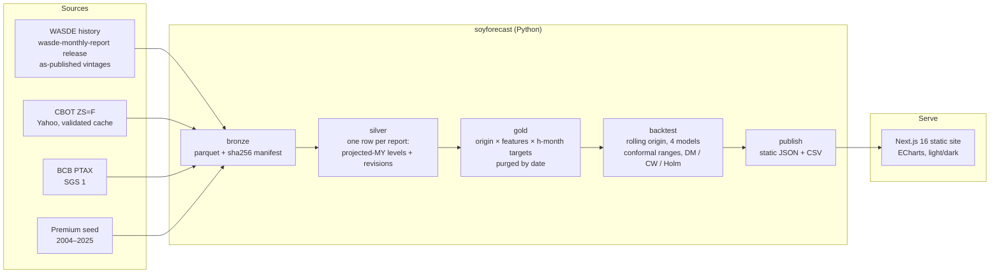

# Soy Outlook: Brazilian soybean prices after each WASDE

**Where could Paranaguá export soybeans trade 1, 3 and 6 months after a USDA WASDE report, and how sure can anyone be?**

**[Live site → soy-outlook.vercel.app](https://soy-outlook.vercel.app)**

Built by **Diego Rossi** · [LinkedIn](https://www.linkedin.com/in/rossi-diego/)

[](https://github.com/rossi-diego/sarimax-brazilian-soybean-forecasting/actions/workflows/ci.yml)


[](https://github.com/astral-sh/ruff)
[](https://soy-outlook.vercel.app)
[](LICENSE)


---

## The answer, in one paragraph

The Paranaguá FOB price is the CBOT soybean price plus a port premium. This project forecasts the CBOT part after every WASDE since July 2010, using only what was public that day. **No model beat "no change".** That includes ARIMA, the average past change and a ridge regression on WASDE revisions, and it holds for both the 2016–2023 validation period and the untouched 2024–2026 holdout. What the project does deliver:

1. **A tested range.** Over 2016–2023, the 1-month 80% range held the actual price 79% of the time; on the holdout it held 81%.
2. **The price of a WASDE revision on release day.** For example, +1 pp of US soybean stocks-to-use has moved CBOT by −2.1 ± 0.9 USD/t on the day.
3. **The premium and the exchange rate as explicit inputs.** That turns the CBOT range into FOB USD/t or R$ per sack.

| CBOT, USD/t, mean absolute error | 1 month | 3 months | 6 months |
|---|---|---|---|
| No change (random walk), validation 2016–2023 | **20.3** | **37.3** | **50.8** |
| ARIMA(0,1,1) | 20.5 | 37.3 | 51.0 |
| Average past change | 20.4 | 38.0 | 52.4 |
| WASDE ridge regression | 21.3 | 38.7 | 53.9 |
| No change, holdout 2024-01 → 2026-10 | 14.2 | 20.3 | 31.4 |
| 80% range hit rate, validation / holdout | 79% / 81% | 74% / 90% | 70% / 85% |

Values as of the CBOT close of 6 Nov 2026 and the October 2026 WASDE. They regenerate on every run (`web/public/data/metrics.csv`).

- **The ridge model is significantly *worse*** than no change at 1 and 6 months: Diebold-Mariano p = 0.046 and 0.017 (0.10 at 3 months).
- **No challenger passes** the Clark-West test against no change, Holm-adjusted across horizons (all adjusted p = 1.0).
- **The 6-month range is too narrow** in validation: it held 70% of outcomes, not 80%. The page shows these hit rates next to every range.

## What the first version got wrong

The original repository claimed a **1.46% MAPE against 13.6% for a naive forecast**. Three agents audited it independently (ML rigour, data sourcing, stakeholder product) and agreed on the findings below:

| Problem | Where | Effect |
|---|---|---|
| A feature multiplied corn by the **target itself** (`corn_soy_price_interaction = corn_quote * soybean`), and it ranked as the "74% driver" | `notebooks/archive/04-sarimax.ipynb` | Leakage. A replica of the model reproduces 1.45% |
| Corn was averaged over the **same window as the target** | `eda_utils.py` | Look-ahead |
| The naive benchmark repeated a price **12 months stale** | notebook, cell 1 | The honest one-step random walk scores 3.6%, not 13.6% |
| `auto_arima(exogenous=…)` was silently ignored, and orders and features were chosen on the full sample | notebook | Selection leakage |
| The Streamlit app plotted **synthetic** prices, forecasts and "backtest" metrics | `app.py` | Not a real model |
| WASDE "current year" columns held the *prior* marketing year | `wasde_functions.py` | Mislabelled features |

Everything above was removed. The old notebooks stay in `notebooks/archive/` for the record.

## Pages

| Page | Question it answers |
|---|---|
| **Outlook** | Where could FOB / CBOT / R$ per sack be in 1, 3 and 6 months, within an 80% and a 95% range? Premium and FX are your inputs. |
| **This WASDE** | What changed in the latest report? What has the market paid on release day for each revision? Includes a what-if calculator. |
| **Track record** | Did any model beat "no change"? Shows errors by horizon, hit rates, past forecasts against actual prices, and the statistical tests. |
| **Methodology** | Plain-language method, units, limitations and the audit of v1. |

| This WASDE | Track record |
|---|---|
|  |  |

## Architecture



**Rules that keep it honest:**
- **Point in time.** Every WASDE value is the one published that day.
- **Origin.** A forecast is made at the CBOT close on release day (USDA publishes at 12:00 ET; CBOT closes at 13:20 CT).
- **Validation never overlaps the holdout.** A validation row counts only if its outcome is dated before 2024-01-01.
- **Purging by date.** A past row can fit a model, choose the ridge penalty or calibrate a range only if its outcome date is on or before the forecast date. Unit tests check this.
- **Fixed feature set.** The 11 features are chosen in advance, with no data-driven selection.
- **Champion rule.** A model replaces "no change" only if it wins on validation with Clark-West, Holm-adjusted p < 0.10. The holdout is reported once and never used to choose anything.

## Quick start (under 5 minutes)

```bash
git clone https://github.com/rossi-diego/sarimax-brazilian-soybean-forecasting.git
cd sarimax-brazilian-soybean-forecasting
docker compose up          # pipeline (~1 min), then the site on http://localhost:3000
```

Without Docker:

```bash
python -m venv .venv && source .venv/bin/activate   # Windows: .venv\Scripts\activate
pip install -e ".[dev]"
soyforecast run                                     # writes web/public/data/*.json
cd web && npm ci && npm run build && npx serve out  # or: npm run dev
```

The repository ships the latest `web/public/data`, so `cd web && npm ci && npm run dev` works without running the pipeline. No API keys are needed; every source is public. The optional settings are listed in `.env.example`.

## Development

```bash
make test     # pytest: no-look-ahead, purging, intervals, stats, units, cache checks, end-to-end JSON contract
make lint     # ruff, mypy, eslint, tsc
make e2e      # Playwright on desktop and mobile, including a no-horizontal-scroll check
```

CI runs the Python checks, then the live pipeline, then the site build and Playwright on every push, and again on weekdays after the CBOT close.

```
├── src/soyforecast/
│   ├── ingest/       wasde.py · prices.py (validated cache) · fx.py (PTAX) · premium.py
│   ├── features/     vintages.py (projected MY, revisions) · dataset.py (origins, targets, roll flags)
│   ├── models/       ladder.py (rw, drift, arima, ridge) · live.py (forecast, release-day reaction)
│   ├── evaluation/   backtest.py (purging, conformal ranges, champion) · stats.py (DM-HLN, Clark-West, Holm)
│   ├── publish/      web_json.py
│   ├── pipeline.py · cli.py · config.py (pre-registered horizons, splits, features) · units.py · logs.py
├── tests/            23 tests, 87% coverage
├── web/              Next.js static site (Outlook, This WASDE, Track record, Methodology)
├── data/seed/        paranagua_premium.csv (the only committed data)
└── notebooks/archive/  v1 notebooks, kept for the audit trail
```

## Limitations

- **Premium source.** It has no public, licensed feed. The seed is a terminal export with unrecorded provenance, and it stops in June 2025. On the site the premium is a user input with a seasonal default.
- **Contract rolls.** The continuous front month jumps at expiry. Windows that cross a roll partly measure a calendar spread; the July–September rolls (old crop to new crop) are the largest. Metrics without those windows are in `metrics.csv` (`subset = no_crop_roll`), and the conclusion is the same.
- **Revisions, not surprises.** A "revision" is a change against the previous report, not against analyst expectations. Release-day sensitivities therefore understate the true surprise effect, and some coefficients (Brazil crop) have weak evidence and an unexpected sign.
- **Low power at long horizons.** 3- and 6-month windows overlap, so there are few independent outcomes, and the tests there have little power.
- **Not investment advice.**

## Data sources

- USDA WASDE, via [WASDE Tracker](https://github.com/rossi-diego/wasde-monthly-report): every report since July 2010, as published.
- CBOT soybean futures, Yahoo Finance `ZS=F`. The response checks follow [soybean-crush-margin](https://github.com/rossi-diego/soybean-crush-margin).
- Banco Central do Brasil, PTAX selling rate (SGS series 1).
