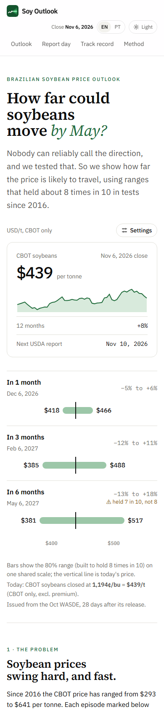
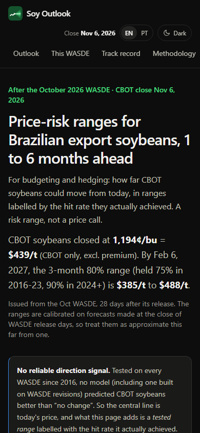
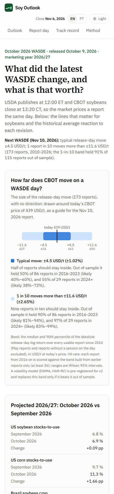
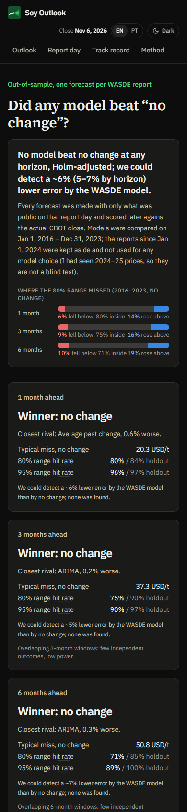
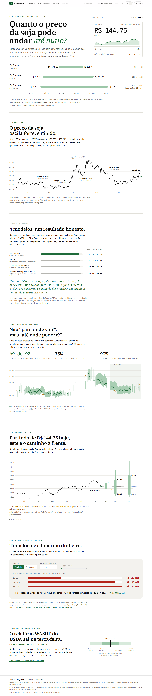
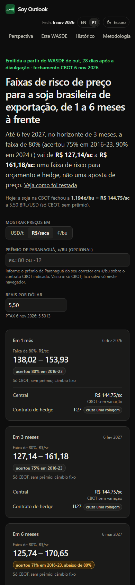
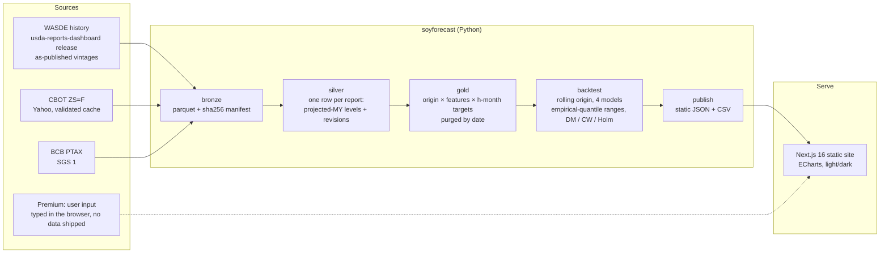

# Soy Outlook: Brazilian soybean prices after each WASDE

**Price-risk ranges for Paranaguá export soybeans 1, 3 and 6 months after each USDA WASDE report, for budgeting and hedging, labelled by how often they actually held.**

**[Live site → soy-outlook.vercel.app](https://soy-outlook.vercel.app)**

Built by **Diego Rossi** · [LinkedIn](https://www.linkedin.com/in/rossi-diego/) · [GitHub](https://github.com/rossi-diego)

[](https://github.com/rossi-diego/soy-outlook/actions/workflows/ci.yml)
[](https://github.com/rossi-diego/soy-outlook/actions/workflows/refresh.yml)


[](https://github.com/astral-sh/ruff)
[](https://soy-outlook.vercel.app)
[](LICENSE)

### What this project demonstrates

- **Honest forecast evaluation.** Rolling-origin backtest on every WASDE since 2010 with point-in-time data, purging by date, a validation/holdout split and a model-selection rule fixed in advance (Clark-West, Holm-adjusted).
- **A null result reported as a finding.** No model beats "no change" for CBOT soybeans; the site is built around that, showing ranges labelled by the hit rate they actually achieved instead of a direction call.
- **Market-risk judgement.** FOB = CBOT + port premium, with the premium a user input only (no unlicensed premium data is shipped), FX an explicit input, and bands labelled "CBOT price risk only" until a joint band is earned.
- **Statistics checked for multiplicity and stability.** A release-day event study with HC1 errors, a Holm adjustment (nothing survives it), placebo, split-sample and roll-exclusion checks shown on the site, and an 80% prediction interval in the what-if, which opens on the post-2018 fit because the effect is not stable.
- **Built for both audiences.** English by default (USD/t), with a client-side Portuguese (pt-BR) toggle that follows the browser language and switches to R$/saca, Brazilian number and date formats and an optional, user-supplied port-to-interior discount; numbers and caveats are identical in both, which an end-to-end test checks on every page.
- **Accessible and mobile-first.** Axe-checked, with AA colour contrast, native radio groups, slider value text, a text alternative on every chart and a data table under the forecast and track-record charts; an axe gate in CI (zero serious or critical violations on every route, both themes, both locales) and 390 px phone screenshots below.
- **End-to-end engineering.** Typed Python package (bronze → silver → gold → publish), structured logging, 80%+ test coverage, a static Next.js site with a Playwright contract test that keeps the copy in line with the JSON, CI and Docker.


---

## The answer, in one paragraph

The Paranaguá FOB price is the CBOT soybean price plus a port premium. This project forecasts the CBOT part after every WASDE since July 2010, using only what was public that day. **The finding: no model beat "no change".** That includes ARIMA, the average past change and a ridge regression on WASDE revisions, and it holds for both the 2016–2023 validation period and the 2024–2026 holdout, which was not used for any model choice (I had seen 2024–25 prices, so it is not a blind test). In a liquid futures market that is the expected result, and showing it with a test fixed in advance is more useful than a leaky "1.46% MAPE". What the project does deliver:

1. **A tested range, labelled by what it achieved.** Over 2016–2023, the 1-month 80% range held the actual price 80% of the time; on the holdout it held 84%. The 6-month 80% range held only 71% in validation, and the site says so next to it.
2. **The size of a WASDE release-day move, and an honest read of what drives it.** The typical release-day move is about ±4.5 USD/t (1.0% of the price), and 1 report in 10 moves CBOT by more than ±11.6 USD/t. The revisions jointly explain 18% of those moves, but no single revision coefficient survives a Holm adjustment across the six tested (the strongest, US soybean stocks-to-use, has Holm p = 0.11), and that one is unstable: about −5.7 USD/t per pp in 2010–2017, −0.6 from 2018 (difference p = 0.001).
3. **The premium and the exchange rate as explicit inputs.** With no premium the ranges read in CBOT ¢/bu, CBOT USD/t or CBOT R$ per sack at PTAX, labelled "CBOT only, excl. premium". Type your broker's premium and they become FOB USD/t or FOB R$ per sack, with that one premium held flat, so "CBOT unchanged" means FOB unchanged. There is no premium default: no licensed source exists, so none is shipped.

| CBOT, USD/t, mean absolute error | 1 month | 3 months | 6 months |
|---|---|---|---|
| No change (random walk), validation 2016–2023 | **20.3** | **37.3** | **50.8** |
| ARIMA(0,1,1) | 20.5 | 37.3 | 51.0 |
| Average past change | 20.4 | 38.0 | 52.4 |
| WASDE ridge regression | 21.3 | 38.7 | 53.9 |
| No change, holdout 2024-01 → 2026-10 | 14.2 | 20.3 | 31.4 |
| 80% range hit rate, validation / holdout | 80% / 84% | 75% / 90% | 71% / 85% |
| 95% range hit rate, validation / holdout | 96% / 97% | 90% / 97% | 89% / 100% |

Values as of the CBOT close of 6 Nov 2026 and the October 2026 WASDE. They regenerate on every run (`web/public/data/metrics.csv`).

- **No challenger passes** the Clark-West test against no change, Holm-adjusted across all nine model × horizon tests (all adjusted p = 1.0).
- **The tests had power.** The minimum detectable effect (one-sided 5%, 80% power, HAC errors) is about a 6% lower MAE for the ridge model (5–7% across horizons) and 1–4% for ARIMA and the average past change. Improvements that size were detectable; none was found.
- **The ridge model is *worse*** than no change. On the primary loss (squared log-return error) Diebold-Mariano p = 0.06, 0.11 and 0.07 at 1, 3 and 6 months; on the secondary absolute USD/t error, p = 0.046 and 0.017 at 1 and 6 months. The average past change is worse at 1 month (p = 0.02).
- **Inference rule v2.** Version 1 mixed losses (DM on USD/t absolute errors, Clark-West on squared log returns, a MAE tie-break) and used an iid binomial direction test on overlapping windows. Version 2, fixed in `config.py` on 2026-11-08, uses one primary loss, Holm across all nine tests, a champion that must also have the lower primary loss, and a HAC Pesaran-Timmermann direction test. No conclusion changed.
- **The 6-month range is too narrow** in validation: it held 71% of outcomes, not 80%. The page shows these hit rates next to every range.
- **How the ranges are built.** Empirical quantiles of the last 60 realized out-of-sample errors, centred on their median. The centring (raw vs median) was fixed as a two-way choice in `config.py` before the comparison was run and chosen on validation only by interval score (median: 0.974 of the raw score). On the holdout it scored 1.008, slightly worse, which is reported rather than acted on. It is *not* split-conformal: overlapping windows break exchangeability, and each 95% bound rests on one or two past errors.
- **Volatility-scaled ranges did not beat it.** Two alternatives were fixed in `config.py` before any result: EWMA(λ = 0.94) filtered historical simulation (the one challenger) and a plain lognormal band from 63-session realized vol (the naive benchmark). On validation their interval scores were 1.10 and 1.07 times the baseline's, so the empirical ranges stay. On the holdout the plain vol band scored 0.80, better; that is reported, not acted on, because the holdout never chooses.
- **How uncertain the hit rates are.** Each comes with a moving-block bootstrap 95% CI and an effective sample size: the 6-month 80% range held 71% in validation, likely 54–87%, from about 32 independent outcomes. Misses are split by tail: in validation most 80% misses are on the upside (19% of 6-month outcomes above the range, 10% below). For the published (no change) ranges, Kupiec and Christoffersen tests on non-overlapping subsamples find no rejection at 5%.

## What the first version got wrong

The original repository claimed a **1.46% MAPE against 13.6% for a naive forecast**. I audited it from three angles (ML rigour, data sourcing, stakeholder product), using a separate AI-assisted review for each as a second pair of eyes, and confirmed the findings below:

| Problem | Where | Effect |
|---|---|---|
| A feature multiplied corn by the **target itself** (`corn_soy_price_interaction = corn_quote * soybean`), and it ranked as the "74% driver" | `notebooks/archive/04-sarimax.ipynb` | Leakage. A replica of the model reproduces 1.45% |
| Corn was averaged over the **same window as the target** | `eda_utils.py` | Look-ahead |
| The naive benchmark repeated a price **12 months stale** | notebook, cell 1 | The honest one-step random walk scores 3.6%, not 13.6% |
| `auto_arima(exogenous=…)` was silently ignored, and orders and features were chosen on the full sample | notebook | Selection leakage |
| The Streamlit app plotted **synthetic** prices, forecasts and "backtest" metrics | `app.py` | Not a real model |
| WASDE "current year" columns held the *prior* marketing year | `wasde_functions.py` | Mislabelled features |

Everything above was removed. The old notebooks stay in `notebooks/archive/` for the record.

## Pages

| Page | Question it answers | What is on it |
|---|---|---|
| **Outlook** | How far could soybeans move by the 6-month target? | A story read top to bottom. The hero answers first: today's price, its 12-month line and the next USDA report on a ticket, and the 1, 3 and 6-month 80% ranges on one shared scale, with a flag where a range held fewer than 8 in 10. Six short chapters follow: the price history with the pre-registered stress episodes, the model contest (validation MAE at 3 months, no model beats "no change"), every past 3-month range against the actual price with the holdout shaded, today's ranges, a calculator for the 1-in-10 bad case vs locking in today's price (seller or buyer, volume, hedged share), and the next WASDE with the typical release-day move. Unit (¢/bu, USD/t, R$/sack), FX and your Paranaguá premium sit in a Settings button; FOB appears only once you type a premium (kept in your browser). |
| **Report day** | How much does CBOT move on WASDE release day, and on what? | Release-day band (±4.5 USD/t typical, ±11.6 for 1 report in 10) with its out-of-sample hit rate, the latest revisions, a what-if with an 80% prediction interval (opens on the 2018+ fit), and a *How stable is this?* block. |
| **Track record** | Did any model beat "no change"? | One-line verdict with the minimum detectable effect, misses by tail, a dot plot of errors vs no change, past forecasts vs prices, published outlooks vs outcomes. Formal tests sit in a **For statisticians** fold; today's outlook in full detail (range cards with hedge contracts and rolls, how to read the ranges, the full decision panel with 1-in-40 and the target-price readout, the stress replay) in a **For analysts** fold. |
| **Method** | How was it built, and what are the limits? | Method, units, limitations and the v1 audit. |

| Report day | Track record |
|---|---|
|  |  |

On a phone (390 px): the hero stacks above the ranges, the story charts redraw at the column width (numbered episode markers instead of labels), ECharts charts are 260 px high, segmented controls use short labels and the WASDE and test tables become labelled rows.

| Outlook, light | Outlook, dark | Report day, light | Track record, dark |
|---|---|---|---|
|  |  |  |  |

In Portuguese (pt-BR), the same page defaults to R$/saca with Brazilian number and date formats; every number matches the English page.

| Panorama, desktop | Panorama, celular (escuro) |
|---|---|
|  |  |

## Architecture



**Rules that keep it honest:**
- **Point in time.** Every WASDE value is the one published that day.
- **Origin.** A forecast is made at the CBOT close on release day (USDA publishes at 12:00 ET; CBOT closes at 13:20 CT).
- **Validation never overlaps the holdout.** A validation row counts only if its outcome is dated before 2024-01-01.
- **Purging by date.** A past row can fit a model, choose the ridge penalty or calibrate a range only if its outcome date is on or before the forecast date. Unit tests check this.
- **Fixed feature set.** The 11 features are chosen in advance, with no data-driven selection.
- **Champion rule.** A model replaces "no change" only if it wins on validation with Clark-West, Holm-adjusted p < 0.10. The holdout is reported, never used to choose anything; since I had seen 2024–25 prices, it is not a blind test.

## Quick start (under 5 minutes)

```bash
git clone https://github.com/rossi-diego/soy-outlook.git
cd soy-outlook
docker compose up          # pipeline (~1 min), then the site on http://localhost:3000
```

Without Docker:

```bash
python -m venv .venv && source .venv/bin/activate   # Windows: .venv\Scripts\activate
uv sync --locked --extra dev                        # exact versions from uv.lock (or: pip install -e ".[dev]")
soyforecast run                                     # writes web/public/data/*.json
cd web && npm ci && npm run build && npx serve out  # or: npm run dev
```

The repository ships the latest `web/public/data`, so `cd web && npm ci && npm run dev` works without running the pipeline. No API keys are needed. WASDE, CBOT and PTAX are fetched from public sources; no premium data is shipped: the premium is a user input (see [DATA_LICENSES.md](DATA_LICENSES.md)). The optional settings are listed in `.env.example`.

## Development

| Command | What it runs |
|---|---|
| `make test` / `make test-fast` | pytest with coverage / without the slow end-to-end runs (about 6 s) |
| `make lint` | ruff, mypy, eslint, tsc |
| `make e2e` | Playwright on desktop and mobile: copy-vs-JSON contract, axe, stale banner, archive, no horizontal scroll |
| `make schema` | after editing `publish/schema.py`: re-export JSON Schema and regenerate `web/lib/types.generated.ts` |
| `make ci-offline` | the hermetic CI run: offline pipeline on synthetic fixtures, then the validation gate |
| `cd web && npm run test:unit` | vitest: units, FX parsing, labels, what-if interval, stability copy |
| `cd web && npm run size` | after a build: per-page HTML and first-load JS budgets, ECharts never in first-load scripts |

How data reaches the site, in short (details and owner setup in [docs/REFRESH.md](docs/REFRESH.md)):

- **`ci.yml` (push, PR) is hermetic:** SHA-pinned actions, `uv.lock`, Python 3.11 and 3.12, Docker build, an offline pipeline run behind a dead-proxy tripwire, then the site build and Playwright.
- **`refresh.yml` (weekdays after the CBOT close, plus a WASDE-day pass):** live run → `soyforecast validate` gate → site build and e2e → bot PR with auto-merge; a `data-alert` issue when a run is stale, degraded or failed.
- **A checked contract:** every published file is a pydantic model, exported to JSON Schema and generated TypeScript types and validated again in `next build`; publish is staged and swapped atomically.
- **Pinned, traceable inputs:** WASDE pinned by release tag and sha256, PTAX bounds checks, cache fallback marked as degraded, and a `run_manifest.json` with input hashes, the `uv.lock` hash and the git commit.
- **Append-only outlook archive:** each published outlook is kept and scored once its date passes; a revised close goes into `<date>.rN.json` and only the first record is scored.

```
├── src/soyforecast/
│   ├── ingest/       wasde.py · prices.py (validated cache) · fx.py (PTAX)
│   ├── features/     vintages.py (projected MY, revisions) · dataset.py (origins, targets, roll flags) · vol.py (EWMA / realized vol at each close) · contracts.py (reference contract, roll crossing)
│   ├── models/       ladder.py (rw, drift, arima, ridge) · live.py (forecast, release-day reaction) · stress.py (historical stress replay)
│   ├── evaluation/   backtest.py (purging, range methods and their rule, centring rule, calibration stats, champion) · stats.py (DM-HLN, Clark-West, Holm, HAC / block-bootstrap hit-rate CIs, Kupiec, Christoffersen, MDE, Pesaran-Timmermann)
│   ├── publish/      schema.py (pydantic site contract) · web_json.py (validated, staged publish) · archive.py (append-only outlook archive) · lineage.py (run manifest) · validate.py (refresh gate)
│   ├── pipeline.py · cli.py · errors.py (exit codes) · config.py (pre-registered horizons, splits, features) · freshness.py (close guard, source status) · fixtures.py · units.py · logs.py
├── tests/            110 tests: no look-ahead, intervals, event study, ingest checks (httpx.MockTransport), JSON contract, close guard, gate, archive
│   └── fixtures/bronze/  synthetic WASDE, CBOT and PTAX inputs for the hermetic CI run
├── web/              Next.js static site (Outlook, Report day, Track record, Method)
│   └── scripts/      brand-assets.mjs: static social card (og.png) and icons from their sources
├── data/wasde.lock.json  WASDE input pin (release tag + sha256), the only committed data; no premium data is shipped
└── notebooks/archive/  v1 notebooks, kept for the audit trail
```

## Limitations

- **Premium source.** It has no public, licensed feed, so the repository ships no premium data, raw or derived, and the site has no premium default: FOB appears only once you type a quote. Earlier commits still hold a former terminal export and a derived table (see [DATA_LICENSES.md](DATA_LICENSES.md)).
- **Forecast origin.** Ranges are tested from WASDE release-day closes. The live forecast is issued from the latest close, some days after the report (`days_since_report` in `meta.json`).
- **Contract rolls.** The continuous front month jumps at expiry. Windows that cross a roll partly measure a calendar spread; the July–September rolls (old crop to new crop) are the largest. Metrics without those windows are in `metrics.csv` (`subset = no_crop_roll`), and the conclusion is the same. Each outlook card names its reference (hedge) contract, the first contract whose first notice day is after the target date (today: F27, H27, N27), and flags a window in which the continuous front month itself rolls, at a contract's last trading day (`contract.crosses_roll` in `outlook.json`, `roll_cross` on every backtest row). On 6 Nov 2026 the front month was X26 (last trade 13 Nov), so all three windows crossed a roll.
- **Stress replay.** `outlook.json` also replays five episodes fixed in advance (Jun 2018 trade war, Jul 2020 China buying, May 2021 correction, Feb 2022 Ukraine, Jul 2024 sell-off) on today's price, next to the full distribution of h-month returns since 2004. They are illustrative scenarios, not probabilities, and CBOT only: no premium is added, and the R$/sack figure converts the CBOT price at today's PTAX.
- **Revisions, not surprises.** A "revision" is a change against the previous report, not against analyst expectations. Release-day sensitivities therefore understate the true surprise effect. None of the six survives Holm adjustment; two (Brazil crop, China imports) have the unexpected sign and are flagged but kept in the what-if total, since dropping them would be post-hoc selection. A placebo on the session five days before each release finds nothing (joint p = 0.21). The strongest line is not stable: the US soybean stocks-to-use effect is −5.7 ± 1.3 USD/t per pp in 2010–2017 (80 reports) but −0.6 ± 0.7 in 2018–2026 (93 reports), difference p = 0.001, and the six revisions together are not distinguishable from zero after 2018 (joint p = 0.14). Excluding release days within three business days of a contract expiry (85 of 173) also removes it (−1.1 ± 1.0 USD/t; joint p = 0.59), though that check halves the sample and so loses power. The site shows all three checks on the WASDE page. By a display rule fixed in `config.py` (`WHATIF_DEFAULT_FIT`, 8 Nov 2026), the what-if opens on the 2018+ fit with that fit's own HC1 covariance and residual sd, and a toggle switches to the full sample. That interval is not wider than the full-sample one: release-day moves since 2018 have been smaller (residual sd 6.2 vs 6.9 USD/t).
- **Low power at long horizons.** 3- and 6-month windows overlap, so there are few independent outcomes, and the tests there have little power.
- **Not investment advice.**

## Data sources

Licences and terms for each source are in [DATA_LICENSES.md](DATA_LICENSES.md).

- USDA WASDE, via [USDA Reports Dashboard](https://github.com/rossi-diego/usda-reports-dashboard): every report since July 2010, as published.
- CBOT soybean futures, Yahoo Finance `ZS=F` (delayed CME data). The response checks follow [soybean-crush-margin](https://github.com/rossi-diego/soybean-crush-margin).
- Banco Central do Brasil, PTAX selling rate (SGS series 1).
- Paranaguá premium: not distributed; a user input only.

## Roadmap

- **Contract-consistent targets (v2.1).** Rebuild the targets on specific contracts, or on a ratio-back-adjusted series with explicit roll dates, so a 3- or 6-month window no longer mixes price moves with calendar spreads. It would be pre-registered and documented as v2.1, the holdout would then be viewed a second time (and disclosed as such), and it needs legally sourceable expired-contract data, avoiding the licensing problem that kept a premium series out of the repository.

- **A volatility ladder for the release-day move (v2, pre-registered 2026-11-08 in [docs/PLAN.md](docs/PLAN.md)).** Unconditional → EWMA → HAR-RV → HAR-RV + WASDE features on |release-day return| and realized variance, scored by QLIKE and DM inside the inference-rule Holm family. The result is published even if every rung loses; the /wasde band changes only if one beats it out of sample.

- **A public premium source.** A CEPEA/ESALQ-implied Paranaguá premium (R$/60 kg ÷ PTAX, minus CBOT nearby, with full lineage) as an optional reference next to the user's own quote.
